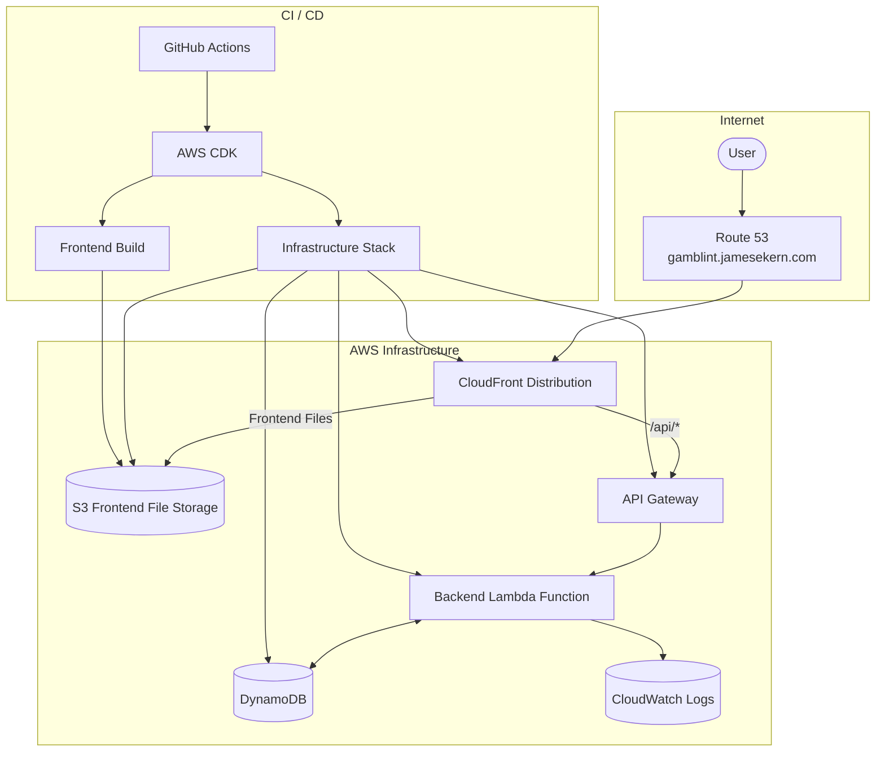

# Welcome to your CDK TypeScript project

This is a blank project for CDK development with TypeScript.

The `cdk.json` file tells the CDK Toolkit how to execute your app.

## Useful commands

(Make sure Docker Desktop is running)

- `pnpm test` perform the jest unit tests
- `pnpm synth` deploy this stack to your default AWS account/region

## Infrastructure Graph

